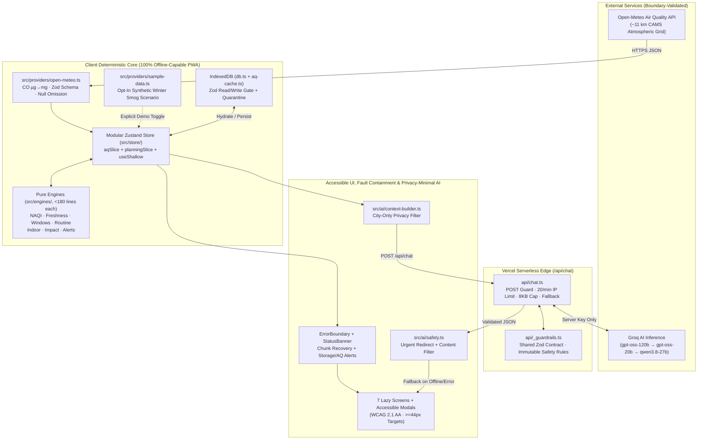
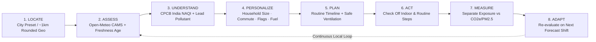
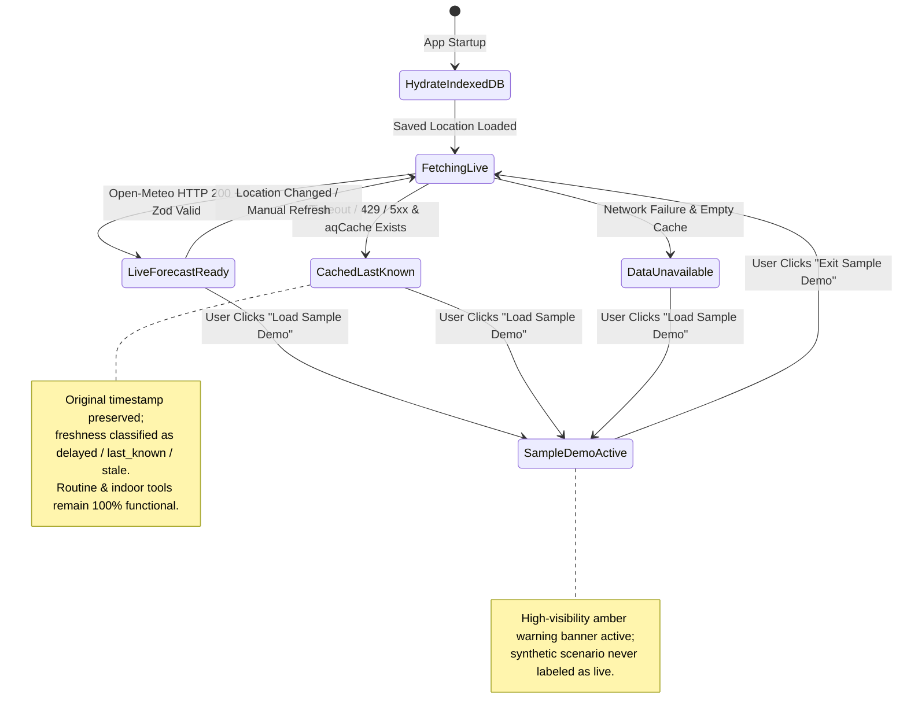
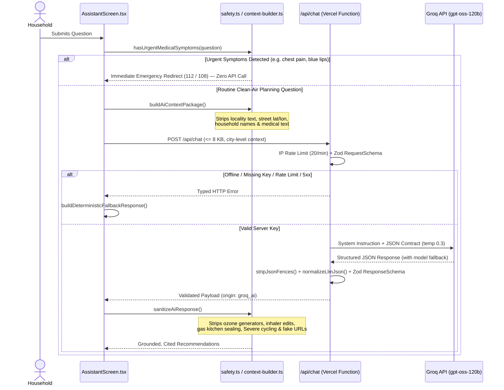

# Saansathi — Your Family's Everyday Clean-Air Companion

**Make everyday choices for cleaner air.**

[](https://saansathi.vercel.app/)
[](package.json)
[-3178C6?style=flat-square&logo=typescript&logoColor=white>)](tsconfig.json)
[](.oxlintrc.json)
[](docs/TESTING.md)
[](vitest.config.ts)
[](tests/e2e/saansathi.spec.ts)
[](docs/ACCESSIBILITY.md)
[-F55036?style=flat-square>)](api/chat.ts)
[](docs/OFFLINE_SUPPORT.md)

> **Saansathi** is a **local-first, offline-capable Progressive Web App (PWA)** and **context-aware environmental decision engine** built for Indian households and housing-society communities navigating severe winter smog and everyday urban air pollution. Rather than stopping at a passive AQI dial or wrapping an ungrounded chatbot, Saansathi unifies **live Open-Meteo Copernicus CAMS atmospheric forecasts**, **official CPCB India NAQI mathematical breakpoints**, **10 pure deterministic TypeScript engines**, **Zod-validated IndexedDB persistence**, **WCAG 2.1 AA accessible UI**, and **schema-gated Groq AI synthesis (`openai/gpt-oss-120b` with multi-model fallback)** inside a clean **Functional Core / Imperative Shell** architecture.

---

## Table of Contents

1. [Chosen Vertical, Personas & Explicit Engineering Assumptions](#chosen-vertical-personas--explicit-engineering-assumptions)
2. [Executive Summary: Eliminating AQI Dashboard & LLM Failure Modes](#executive-summary-eliminating-aqi-dashboard--llm-failure-modes)
3. [Evaluation Criteria Mapping Matrix](#evaluation-criteria-mapping-matrix)
4. [How Saansathi Solves Every Challenge 6 Requirement](#how-saansathi-solves-every-challenge-6-requirement)
5. [System Architecture & Visual Diagrams (Mermaid)](#system-architecture--visual-diagrams-mermaid)
6. [Domain Engineering & Scientific Mathematics](#domain-engineering--scientific-mathematics)
7. [Defensive Engineering, CWE Mitigations & Failure-Mode Matrix](#defensive-engineering-cwe-mitigations--failure-mode-matrix)
8. [Design Patterns, Type Safety & Algorithmic Complexity Proofs](#design-patterns-type-safety--algorithmic-complexity-proofs)
9. [Serverless GenAI Endpoint Specification (`/api/chat`)](#serverless-genai-endpoint-specification-apichat)
10. [Accessibility Architecture (WCAG 2.1 AA + Real-Browser `axe-core`)](#accessibility-architecture-wcag-21-aa--real-browser-axe-core)
11. [Production Bundle Footprint, Coverage & Automated Verification](#production-bundle-footprint-coverage--automated-verification)
12. [Repository Structure & Modularity Budget (`<= 200` Lines)](#repository-structure--modularity-budget--200-lines)
13. [Frequently Asked Questions (FAQ) & Technical Documentation Index](#frequently-asked-questions-faq--technical-documentation-index)

---

## Chosen Vertical, Personas & Explicit Engineering Assumptions

### Selected Domain & Target Personas

**Urban Air Quality, Household Resilience & Community Clean-Air Planning (India).**
Saansathi addresses severe urban pollution and winter inversion episodes across Indian cities by serving four distinct user personas with dedicated workflows:

1. **Urban Families:** Households scheduling morning walks, school commutes, and afternoon play safely around diurnal $\text{PM}_{2.5}/\text{PM}_{10}$ curves.
2. **Health-Conscious Households:** Homes protecting children, older adults (`60+`), pregnant members, or sensitive individuals using local-only priority protection toggles without storing clinical records.
3. **Daily Commuters:** Travellers comparing 12 Indian transport modes across decoupled **Personal Exposure** and **WRI India Avoided $\text{CO}\_2\text{e}$**.
4. **Resident Communities (RWAs & Schools):** Coordinators managing local action checklists and privacy-safe summaries without unverified social feeds.

### Explicit Assumptions & Honest Scientific Limitations

- **Spatial Model Resolution (`~11 km`):** Open-Meteo Copernicus CAMS forecasts represent regional grid estimates rather than roadside or rooftop CPCB regulatory stations; Saansathi discloses this caveat on every dashboard and chart.
- **Averaging-Period Honesty:** Hourly forecast model values (`1h`) are mapped transparently against CPCB's `24h` / `8h` breakpoint tables with an explicit `averagingPeriodWarning` whenever intervals differ.
- **Null-Preserving Telemetry & Factors:** Missing pollutants and vehicle-specific tailpipe $\text{PM}_{2.5}/\text{NO}_x$ rates (`car_ev`, `bus`, `metro`) remain `null` (`"Omitted (varies)"`)—never fabricated from $\text{CO}_2\text{e}$.

---

## Executive Summary: Eliminating AQI Dashboard & LLM Failure Modes

Conventional urban air-quality applications suffer from two systemic engineering flaws:

1. **Passive Number Displays:** Showing `"AQI 376"` fails to answer practical household questions: _Should morning runners move indoors at 6:30 AM? When is the safest 2-hour daytime ventilation dip? Must LPG kitchen exhaust fans stay on even when windows are closed? Which commute shift cuts emissions without increasing rider particulate inhalation?_
2. **Ungrounded LLM Wrappers:** Delegating numeric breakpoints, emission calculations, or medical guidance directly to generative AI causes hallucinated station numbers, unsafe advice (such as recommending ozone air cleaners or sealing kitchens with active gas stoves), and contradictory recommendations (telling commuters to bicycle 15 km through `Severe` 420 NAQI winter smog).

Saansathi solves both failure modes through a deterministic **Eight-Stage Clean-Air Intelligence Loop** paired with a **Dual-Interface Principle** (100% deterministic GUI parity + schema-gated Groq AI explanation shell):

$$\textbf{LOCATE} \longrightarrow \textbf{ASSESS} \longrightarrow \textbf{UNDERSTAND} \longrightarrow \textbf{PERSONALIZE} \longrightarrow \textbf{PLAN} \longrightarrow \textbf{ACT} \longrightarrow \textbf{MEASURE} \longrightarrow \textbf{ADAPT}$$

| Engineering Dimension           | Conventional AQI App                        | Unbounded LLM Chatbot                                | **Saansathi Architecture**                                                                                                             |
| :------------------------------ | :------------------------------------------ | :--------------------------------------------------- | :------------------------------------------------------------------------------------------------------------------------------------- |
| **Scale & Provenance**          | Silently substitutes US EPA or EAQI numbers | Invents station readings or outdated ranges          | **Exact CPCB India NAQI** (`src/engines/aqi-interpreter.ts`) with CO $\mu\text{g}\to\text{mg}$ conversion & 3-pollutant coverage rule  |
| **Exposure vs. Emissions**      | Ignores daily routine trade-offs            | Conflates carbon reductions with health safety       | **Strictly decoupled engines & UI tracks**; explicitly warns against active cycling when NAQI $> 200$                                  |
| **Indoor Air Safety**           | Generic blog tips                           | May hallucinate ozone generators or airtight sealing | **Combustion-safe deterministic toolkit** (`src/engines/indoor-engine.ts`) with CADR room math & hard ozone/myth bans                  |
| **Resilience & Offline Mode**   | Blank error page offline                    | Broken when API key or network is unavailable        | **Workbox PWA + Zod-validated IndexedDB + `ErrorBoundary` + Deterministic Offline Assistant Fallback**                                 |
| **Privacy & Data Minimization** | Uploads precise GPS & analytics             | Sends raw personal context in prompts                | **City-level context minimization** (`src/ai/context-builder.ts`); household names, coordinates & health flags stay local              |
| **Verification Rigor**          | Minimal smoke tests                         | Untested prompt strings                              | **147 Vitest tests + enforced V8 thresholds (`93.4%` stmts / `95.5%` lines) + 4 Playwright E2E + Chromium `axe-core` contrast checks** |

---

## Evaluation Criteria Mapping Matrix

Every evaluation dimension maps directly to dedicated root proof documents, verifiable source modules, and automated CI checks:

| Dimension                       | Architectural & Root Document Proof                                                                                                                                                                                                                                     | Verifying Files & Automated Checks                                                                                                     | Measured Proof                                                                      |
| :------------------------------ | :---------------------------------------------------------------------------------------------------------------------------------------------------------------------------------------------------------------------------------------------------------------------- | :------------------------------------------------------------------------------------------------------------------------------------- | :---------------------------------------------------------------------------------- |
| **Problem Statement Alignment** | [PROBLEM_ALIGNMENT.md](PROBLEM_ALIGNMENT.md) — Complete Challenge 6 persona parity, CPCB NAQI first, exposure-vs-emission separation, zero vaporware                                                                                                                    | `src/engines/*`, `src/components/*`, `tests/integration/end-to-end-pipeline.test.ts`                                                   | **7/7 routes** + full deterministic GUI fallback                                    |
| **Code Quality**                | [CODE_QUALITY.md](CODE_QUALITY.md) — TypeScript `strict` + `noUncheckedIndexedAccess` across `src/`, `api/`, `tests/`; zero `any`/`!`/casts; `useShallow` selectors; modular Zustand slices; every `src/` & `api/` file `<= 200` lines; Tailwind v4 `@theme` tokens     | `tsconfig.json`, `tsconfig.test.json`, `src/store/*`, `src/domain/select-guards.ts`, `.oxlintrc.json`, `tests/quality/hygiene.test.ts` | **0 TS errors · 0 Oxlint warnings** (`105` files) · **100% modules `<= 200` lines** |
| **Efficiency**                  | [EFFICIENCY.md](EFFICIENCY.md) — Zero-dependency responsive hourly chart, `React.lazy()` route code splitting, `useShallow` selectors, 300 ms debounced IndexedDB writes, $O(1)$ pre-indexed `ReadonlyMap`/`Set` lookups                                                | `src/App.tsx`, `HourlyForecastChart.tsx`, `CommunityScreen.tsx`, `vite.config.ts`                                                      | **105.67 kB** gzipped main chunk · **416 ms** Vite build                            |
| **Testing**                     | [docs/TESTING.md](docs/TESTING.md) — 147 Vitest tests (engines, Zod contracts, Open-Meteo, IndexedDB quarantine, store concurrency, `/api/chat`, UI, onboarding, `ErrorBoundary`, `axe-core`) + 4 Playwright Chromium E2E workflows                                     | `vitest.config.ts`, `tests/unit/**`, `tests/integration/**`, `tests/quality/**`, `tests/e2e/saansathi.spec.ts`                         | **147 / 147 Vitest (`93.38%` stmts, `95.46%` lines)** · **4 / 4 Playwright**        |
| **Security**                    | [SECURITY.md](SECURITY.md) & [docs/SECURITY.md](docs/SECURITY.md) — Server-only `GROQ_API_KEY`, 20 req/min rate limit, 8 KB cap, shared Zod gating, prompt boundaries, urgent `112/108` redirect, CSP/HSTS headers                                                      | `api/chat.ts`, `api/_guardrails.ts`, `src/ai/safety.ts`, `vercel.json`, `tests/unit/ai/server-endpoint.test.ts`                        | **Zero client secrets** · CWE-798/209/20/770 mitigated                              |
| **Accessibility**               | [docs/ACCESSIBILITY.md](docs/ACCESSIBILITY.md) — WCAG 2.1 AA landmarks, skip link, `>= 44×44 px` targets, `scope="col"` + `<caption>` tables, `aria-pressed` toggles, cross-viewport `<output aria-live="polite">`, chart-to-table toggle, Chromium `axe-core` contrast | `src/components/layout/AppShell.tsx`, `Primitives.tsx`, `tests/unit/ui/accessibility.test.tsx`, `tests/e2e/saansathi.spec.ts`          | **0 `axe-core` violations** (unit all-routes + Playwright Chromium CSS contrast)    |

---

## How Saansathi Solves Every Challenge 6 Requirement

Verbatim traceability between every Challenge 6 problem statement keyword, target user persona, and production implementation:

| Challenge Requirement / Persona             | Implemented Capability                                                                                                                                                                                                    | Primary Source Modules                                                                                    | Automated Tests                                                     |
| :------------------------------------------ | :------------------------------------------------------------------------------------------------------------------------------------------------------------------------------------------------------------------------ | :-------------------------------------------------------------------------------------------------------- | :------------------------------------------------------------------ |
| **GenAI-powered assistant**                 | Context-grounded **Ask Saansathi** backed by Groq structured JSON inference (`api/chat.ts`) with 3-model cascade (`gpt-oss-120b -> gpt-oss-20b -> qwen3.8-27b`), urgent medical redirect & offline deterministic fallback | `api/chat.ts`, `api/_guardrails.ts`, `src/ai/client.ts`, `src/ai/safety.ts`, `src/components/assistant/*` | `server-endpoint.test.ts` (10), `ai-safety-and-context.test.ts` (7) |
| **Urban Families (Persona A)**              | First-launch location onboarding modal, household size, school-going child flag, exercise timing, budget tier, and full daily routine slots stored locally in IndexedDB                                                   | `src/App.tsx`, `src/domain/household/types.ts`, `src/components/dashboard/HouseholdModal.tsx`             | `modals.test.tsx` (5), `app-shell.test.tsx` (2)                     |
| **Health-Conscious Households (Persona B)** | Local-only voluntary priority protection toggles (`children`, `older_adults`, `pregnant`, `respiratory_or_heart`) tightening Moderate AQI thresholds (`> 100`) without storing medical records                            | `src/engines/routine-rules.ts`, `src/components/dashboard/HouseholdFormFields.tsx`                        | `routine-engine.test.ts` (9)                                        |
| **Daily Commuters (Persona C)**             | Mode explorer across 12 Indian transport modes (`car_petrol` through `remote`), weekly CO₂e calculator, and explicit `> 200` NAQI cycling/walking conflict alerts                                                         | `src/data/emission-factors.ts`, `src/engines/impact-engine.ts`, `src/components/choices/*`                | `impact-engine.test.ts` (9), `screens.test.tsx` (19)                |
| **Communities (Persona D)**                 | Debounced RWA / school / society clean-air organizer checklist with lead roles, deadlines, status updates, and privacy-safe clipboard summary export                                                                      | `src/data/community-templates.ts`, `src/components/community/*`                                           | `screens.test.tsx`, `saansathi.spec.ts`                             |
| **Location Intelligence**                   | 15 preset Indian cities with winter-smog advisories, custom locality labels, and opt-in consent-first geolocation rounded to `~1 km` (`0.01°`)                                                                            | `src/data/cities.ts`, `src/components/dashboard/LocationModal.tsx`, `GeoConsentPanel.tsx`                 | `registries.test.ts` (5), `modals.test.tsx` (5)                     |
| **Severe winter smog**                      | Official CPCB India NAQI sub-index calculation, hourly diurnal chart/table, 12-hour forecast spike alerts, and evening temperature-inversion guidance                                                                     | `src/engines/aqi-interpreter.ts`, `src/engines/alert-engine.ts`, `HourlyForecastChart.tsx`                | `aqi-interpreter.test.ts` (13), `alert-and-freshness.test.ts` (11)  |
| **Low-emission daily routines**             | Deterministic timeline covering morning fitness, commute shifts / outdoor-work pacing, school pickup windows, errand consolidation, and evening wind-down                                                                 | `src/engines/routine-engine.ts`, `routine-rules.ts`, `routine-commute-rules.ts`, `RoutineScreen.tsx`      | `routine-engine.test.ts` (9), `screens.test.tsx`                    |
| **Indoor air quality hacks**                | Safe ventilation window advisor paired with LPG/PNG/biomass combustion exhaust warnings, source control checklists, CADR room sizing, and hard ozone/myth exclusions                                                      | `src/engines/indoor-engine.ts`, `src/data/indoor-actions.ts`, `src/components/indoor/*`                   | `indoor-engine.test.ts` (10), `screens.test.tsx`                    |
| **Direct impact of choices**                | Side-by-side **1. Personal Exposure Management** vs. **2. Illustrative Avoided Emissions** with transparent _"How we calculated this"_ formulas and provenance table                                                      | `src/engines/impact-engine.ts`, `src/components/impact/*`                                                 | `impact-engine.test.ts` (9), `end-to-end-pipeline.test.ts` (1)      |
| **Offline & Deterministic Fallbacks**       | Workbox PWA shell, IndexedDB `aqCache`, `ErrorBoundary` lazy-chunk guard, and 100% functional local planning without `GROQ_API_KEY` or internet access                                                                    | `src/storage/*`, `src/components/ui/ErrorBoundary.tsx`, `src/store/*`                                     | `indexeddb.test.ts` (6), `app-store.test.ts` (7)                    |

---

## System Architecture & Visual Diagrams (Mermaid)

### 1. High-Level Functional Core / Imperative Shell Architecture



### 2. Eight-Stage Clean-Air Intelligence Loop



### 3. Data Provenance, Cache Fallback & Demo Isolation State Machine



### 4. Exposure Intelligence vs. Environmental Emissions (Anti-Contradiction Guardrail)


### 5. Groq AI Privacy Minimization, Schema Gate & Safety Sanitization Pipeline



---

## Domain Engineering & Scientific Mathematics

### 1. Exact CPCB India NAQI Computation (`src/engines/aqi-interpreter.ts`, `aqi-subindex.ts`)

Saansathi evaluates all six statutory CPCB pollutants across official India breakpoints (`Good` 0–50, `Satisfactory` 51–100, `Moderate` 101–200, `Poor` 201–300, `Very Poor` 301–400, `Severe` 401–500+) using linear interpolation:

$$I_p = \frac{I_{\text{Hi}} - I_{\text{Lo}}}{C_{\text{Hi}} - C_{\text{Lo}}} \left(C_p - C_{\text{Lo}}\right) + I_{\text{Lo}}, \qquad \text{NAQI} = \max_{p \in \mathcal{P}_{\text{valid}}} I_p$$

- **Unit Normalization:** Open-Meteo supplies CO in $\mu\text{g/m}^3$. `normalizeConcentrationUnit()` converts CO to $\text{mg/m}^3$ ($C_{\text{mg/m}^3} = C_{\mu\text{g/m}^3} / 1000$) prior to bracket lookup.
- **3-Pollutant Coverage Rule:** Sets `minimumCoverageMet = false` with an explicit UI limitation notice if fewer than 3 pollutants are present or if neither $\text{PM}_{2.5}$ nor $\text{PM}_{10}$ is reported.
- **Averaging-Period Transparency:** Explicitly discloses whenever hourly CAMS model predictions (`1h`) are interpreted against CPCB `24h` ($\text{PM}_{2.5}, \text{PM}_{10}, \text{NO}_2, \text{SO}_2$) or `8h` ($\text{CO}, \text{O}_3$) thresholds.
- **Zero Foreign Substitution:** Never swaps US EPA or European EAQI values into `India NAQI`.

### 2. Combustion-Safe Indoor Air & CADR Sizing (`src/engines/indoor-engine.ts`)

- **Hard Combustion Safety Interlock:** When `cookingFuel` is `lpg_gas`, `piped_gas`, `biomass`, or `mixed`, `evaluateVentilationGuidance()` mandates exhaust operation or brief window cracking during active burners to avoid acute indoor $\text{CO}$ and $\text{NO}_2$ accumulation.
- **CADR Room Coverage Formula:** Portable HEPA sizing estimates bedroom effectiveness via $\text{Coverage (m}^2) \approx \text{CADR (m}^3\text{/h)} / 12$ (~4–5 air changes per hour at typical urban ceiling heights).
- **Myth & Hazard Exclusion:** Intentional ozone air cleaners are systematically blocked across registries, engines, system prompts, and regex filters (`epa-ozone-caution`).

---

## Defensive Engineering, CWE Mitigations & Failure-Mode Matrix

### Security & CWE Threat-Model Mitigations

- **CWE-798 (Hardcoded Credentials Prevention):** `GROQ_API_KEY` lives strictly on the server (`api/chat.ts`), `.env*` local secrets are git-ignored while preserving `.env.example`, and `tests/quality/hygiene.test.ts` enforces regex key-leak checks.
- **CWE-209 (Generation of Error Message Containing Sensitive Information):** `api/chat.ts` returns typed generic error codes (`MISSING_API_KEY`, `AI_PROVIDER_ERROR`, `VALIDATION_ERROR`) without exposing upstream headers, stack traces, or keys.
- **CWE-20 (Improper Input Validation):** Single-source Zod schemas (`src/ai/schemas.ts`, `api/_guardrails.ts`, `src/storage/db.ts`) validate every HTTP body, Open-Meteo payload, and IndexedDB record prior to use.
- **CWE-770 (Allocation of Resources Without Limits):** `POST /api/chat` enforces an `8 KB` (`8192`-byte) body cap (`413`) and an IP-keyed sliding-window rate limiter (`20 req / 60s -> 429`).

| Failure Mode / Edge Case                     | Detection Mechanism                           | Graceful Recovery Behavior                                                                                               | Verifying Test                            |
| :------------------------------------------- | :-------------------------------------------- | :----------------------------------------------------------------------------------------------------------------------- | :---------------------------------------- |
| **Offline on Repeat Visit**                  | `navigator.onLine` + Workbox SW               | Reopens precached shell; hydrates last valid IndexedDB snapshot + preserves original reading timestamps                  | `saansathi.spec.ts`                       |
| **Open-Meteo `429` / Timeout / 5xx**         | `OpenMeteoAirQualityProvider` + `AbortSignal` | Throws typed `ProviderError`; loads `aqCache` or displays honest `Data unavailable` + `aqErrorMessage` in `StatusBanner` | `open-meteo.test.ts`, `app-store.test.ts` |
| **Out-of-Order Location Switching**          | `activeAqRequestId` monotonic token           | Drops stale slow HTTP responses so newer city selections are never overwritten                                           | `app-store.test.ts`                       |
| **Corrupted / Quota-Full IndexedDB**         | Zod `safeParse()` + `QuotaExceededError`      | Quarantines bad entries (`errorCode: 'corrupted'`); surfaces `storageWarning` in `StatusBanner`                          | `indexeddb.test.ts`, `app-store.test.ts`  |
| **Groq Primary Model `503` / `429` / `404`** | `handleChatRequest` candidate loop            | Cascades automatically (`gpt-oss-120b` -> `gpt-oss-20b` -> `qwen/qwen3.8-27b`)                                           | `server-endpoint.test.ts`                 |
| **Drifted LLM JSON Shapes**                  | `stripJsonFences()` + `normalizeLlmJson()`    | Strips markdown fences and coerces object-keyed recommendations/string lists before `ResponseSchema.safeParse()`         | `server-endpoint.test.ts`                 |
| **Missing `GROQ_API_KEY` or Offline AI**     | `503 MISSING_API_KEY` / network catch         | Seamlessly renders `buildDeterministicFallbackResponse()` grounded in local household rules                              | `ai-safety-and-context.test.ts`           |
| **Urgent Respiratory Symptoms in Chat**      | `hasUrgentMedicalSymptoms()` regex            | Short-circuits before network call with local emergency guidance (`112 / 108`)                                           | `ai-safety-and-context.test.ts`           |
| **Lazy Route Chunk Load Crash**              | React `ErrorBoundary` around `<Suspense>`     | Renders accessible recovery alert with one-click return to Home dashboard                                                | `primitives.test.tsx`                     |

---

## Design Patterns, Type Safety & Algorithmic Complexity Proofs

### Architectural & TypeScript Guarantees

- **Strict Compiler Enforcement Everywhere:** `tsconfig.app.json`, `tsconfig.node.json`, and `tsconfig.test.json` enforce `strict`, `noImplicitAny`, `strictNullChecks`, `noUncheckedIndexedAccess`, `noUnusedLocals`, and `noUnusedParameters` across `src/`, `api/`, and `tests/`.
- **Single-Source Contracts & Safe Enum Guards:** `src/ai/schemas.ts` and `src/data/evidence-ids.ts` are shared directly with `api/_guardrails.ts` (zero schema duplication). All interactive `<select>` inputs parse via Zod (`parseEnumValue` in `src/domain/select-guards.ts`), leaving **zero `as` casts** and **zero `!` assertions**.
- **Selective Store Subscriptions:** All 7 screens and `App.tsx` subscribe via `zustand/react/shallow` (`useShallow`), preventing unrelated slice updates from re-rendering inactive views.

### Algorithmic Complexity Analysis

Let $P \le 6$ be measured pollutants, $B = 6$ CPCB brackets per pollutant, $H \le 36$ hourly forecast steps, $S \le 6$ routine slots, and $I = 7$ indoor templates.

| Engine Operation              |   Time Complexity    | Space Complexity | Implementation Proof                                                            |
| :---------------------------- | :------------------: | :--------------: | :------------------------------------------------------------------------------ |
| `computePollutantSubIndex`    |    $O(B) = O(1)$     |      $O(1)$      | Fixed 6-tier breakpoint scan per pollutant (`aqi-subindex.ts`)                  |
| `interpretIndiaNAQI`          | $O(P \log P) = O(1)$ |      $O(P)$      | Evaluates up to 6 unique pollutants via `Set` and sorts descending              |
| `findBestOutdoorWindows`      |    $O(H \log H)$     |      $O(H)$      | Linear 2-hour daytime sliding window evaluation + ascending NAQI sort           |
| `evaluateReadingFreshness`    |        $O(1)$        |      $O(1)$      | Pure timestamp age delta classification                                         |
| `generateDailyRoutine`        |      $O(S + H)$      |      $O(S)$      | Calls window finder once, evaluates bounded household rules                     |
| `evaluateVentilationGuidance` |        $O(H)$        |      $O(1)$      | Threshold branch + single best-window lookup                                    |
| `generateIndoorActions`       | $O(I \log I) = O(1)$ |      $O(I)$      | Linear filter/map over 7 evidence templates + priority sort                     |
| `calculateTransportImpact`    |        $O(1)$        |      $O(1)$      | Direct `EMISSION_FACTOR_BY_MODE` `ReadonlyMap.get(mode)` arithmetic             |
| `evaluateCleanAirAlerts`      |        $O(H)$        |      $O(1)$      | Single `Set`-deduplicated pass + 12-hour forecast spike scan                    |
| `sanitizeAiResponse`          |    $O(R \cdot K)$    |      $O(R)$      | Bounded pass ($R \le 6$ recs, $K = 4$ safety regexes, `VALID_SOURCE_IDS` `Set`) |

---

## Serverless GenAI Endpoint Specification (`/api/chat`)

`api/chat.ts` exposes a single Vercel Serverless `POST` endpoint backed by shared Zod contracts (`api/_guardrails.ts`) and mounted identically in Vite dev/preview middleware (`vite.config.ts`).

| Control                         | Configuration                                                                     | Behavior on Violation                                                                               |
| :------------------------------ | :-------------------------------------------------------------------------------- | :-------------------------------------------------------------------------------------------------- |
| **HTTP Method Guard**           | `POST` only (`OPTIONS` 204 in dev)                                                | `405 METHOD_NOT_ALLOWED`                                                                            |
| **Sliding-Window Rate Limiter** | `20` requests / `60s` per client IP                                               | `429 RATE_LIMITED`                                                                                  |
| **Payload Body Cap**            | `MAX_BODY_BYTES = 8192` (`8 KB`)                                                  | `413 PAYLOAD_TOO_LARGE`                                                                             |
| **Request Contract**            | `RequestSchema` (2–800 char question + bounded city context)                      | `400 INVALID_JSON` / `400 VALIDATION_ERROR`                                                         |
| **Credential Isolation**        | Server-side `process.env.GROQ_API_KEY` (never `VITE_*`)                           | `503 MISSING_API_KEY` -> client deterministic fallback                                              |
| **Inference & Fallback Chain**  | `openai/gpt-oss-120b` -> `openai/gpt-oss-20b` -> `qwen/qwen3.8-27b` (`temp: 0.3`) | Cascades automatically on `503`/`429`/`404`; returns `429 AI_RATE_LIMIT` or `502 AI_PROVIDER_ERROR` |
| **Response Gate**               | `stripJsonFences()` + `normalizeLlmJson()` + `ResponseSchema.safeParse()`         | Rejects invalid completions (`502`) before reaching client                                          |

---

## Accessibility Architecture (WCAG 2.1 AA + Real-Browser `axe-core`)

- **Semantic Landmarks & Skip Link:** `<header>`, dual `<nav>` (`Primary navigation` & `Mobile navigation`), `<main id="main-content">`, `<footer>`, and `#main-content` skip link verified via Playwright `Tab` focus test.
- **Universal Accessible Names & `>= 44×44 px` Targets:** All interactive buttons—including header `"Family Context"` (`sr-only sm:not-sr-only`), modal close (`h-11 w-11`), repeated `Mark Done` / `Accept` / `Complete` / `Check off` card toggles (unique `aria-label` + `aria-pressed`), and quick prompts—meet `44 px` touch targets and `WCAG 2.5.3` Label-in-Name.
- **Cross-Viewport Live Regions:** Persistence status (`DesktopNavBar.tsx` `<output aria-live="polite">`), geolocation feedback (`GeoConsentPanel.tsx`), clipboard confirmation (`CommunityScreen.tsx`), impact logging (`ChoicesScreen.tsx`), AI loading (`aria-busy`), and global notices (`StatusBanner.tsx`) announce across mobile and desktop viewports.
- **Data Tables & Chart Parity:** Both `HourlyForecastChart.tsx` (chart <-> table toggle) and `EmissionFactorsTable.tsx` ship `<caption className="sr-only">` and `<th scope="col">`.
- **Dual Automated Audits:** Passes `axe-core` with **zero violations at any severity level** across all 7 screens + both modals in `tests/unit/ui/accessibility.test.tsx`, AND passes real headless Chromium `axe-core` CSS `color-contrast` + WCAG 2.1 AA verification in `tests/e2e/saansathi.spec.ts`.

---

## Production Bundle Footprint, Coverage & Automated Verification

### Production Build Metrics (`npm run build`)

| Asset / Chunk                                             |         Raw Size |                Gzip Size | Strategy                                         |
| :-------------------------------------------------------- | ---------------: | -----------------------: | :----------------------------------------------- |
| `dist/index.html`                                         |        `1.06 kB` |                `0.55 kB` | Minimal SPA shell + manifest links               |
| `dist/assets/index-*.css`                                 |       `32.27 kB` |                `6.74 kB` | Tailwind CSS v4 `@theme` high-contrast palette   |
| `dist/assets/index-*.js`                                  |      `341.16 kB` |              `105.67 kB` | React 19 runtime + Home dashboard                |
| `dist/assets/state-*.js`                                  |       `93.46 kB` |               `26.86 kB` | Vendor split (`zustand`, `idb`, `zod`)           |
| `dist/assets/radix-*.js`                                  |       `50.71 kB` |               `16.84 kB` | Accessible `@radix-ui/react-dialog` primitives   |
| `Routine` / `Choices` / `Impact` / `Indoor` / `Community` |   `5.7 – 7.9 kB` |           `1.8 – 2.6 kB` | On-demand `React.lazy()` route chunks            |
| `AssistantScreen`                                         |       `16.10 kB` |                `6.13 kB` | On-demand AI assistant chunk                     |
| **Workbox Service Worker**                                | **`568.24 KiB`** | **20 precached entries** | Runtime Open-Meteo `NetworkFirst` cache (1h TTL) |

### V8 Coverage Summary (`npm run coverage`)

Enforced thresholds in `vitest.config.ts` (`statements >= 90%`, `branches >= 82%`, `functions >= 88%`, `lines >= 90%`):

| Scope                                                        |  Statements  |   Branches   |  Functions   |    Lines     |
| :----------------------------------------------------------- | :----------: | :----------: | :----------: | :----------: |
| **All Measured (`src/` + `api/`)**                           | **`93.38%`** | **`82.96%`** | **`93.47%`** | **`95.46%`** |
| `api/` (`chat.ts`, `_guardrails.ts`)                         |   `93.40%`   |   `89.83%`   |  `100.00%`   |   `93.97%`   |
| `src/engines/` (all 10 modules)                              |   `93.92%`   |   `88.85%`   |  `100.00%`   |   `96.88%`   |
| `src/ai/` (`context-builder`, `safety`, `schemas`, `client`) |   `93.65%`   |   `86.95%`   |   `81.25%`   |   `98.30%`   |
| `src/providers/`                                             |   `94.84%`   |   `88.46%`   |   `81.81%`   |   `97.82%`   |
| `src/data/` & `src/domain/` & `src/components/ui/`           |  `100.00%`   |  `100.00%`   |  `100.00%`   |  `100.00%`   |

### Local Setup & Full CI Verification Commands

```bash
# 1. Install dependencies cleanly (Node >= 20 required)
npm install

# 2. Configure optional server-side Groq AI credentials
cp .env.example .env.local
# Add GROQ_API_KEY=... and GROQ_MODEL=openai/gpt-oss-120b

# 3. Start local Vite dev server (mounts /api/chat automatically)
npm run dev

# 4. Run full verification gates
npm run typecheck      # tsc -b --noEmit across src/, api/, and tests/ (0 errors)
npm run lint           # oxlint across 105 TS/TSX files (0 warnings, 0 errors)
npm run format:check   # Prettier + Tailwind CSS formatting check
npm run test           # 147 Vitest tests across 20 files
npm run coverage       # V8 coverage + threshold enforcement (src/ + api/)
npm run build          # Production build + Workbox PWA manifest
npm run e2e            # 4 Playwright Chromium E2E + real-browser axe-core contrast tests
npm run check          # Combined gate: typecheck && lint && format:check && test && build
```

---

## Repository Structure & Modularity Budget (`<= 200` Lines)

Every `.ts` / `.tsx` file under `src/` and `api/` is programmatically verified to remain **`<= 200` lines** (`tests/quality/hygiene.test.ts`):

```text
api/
  _guardrails.ts            # Shared Zod contract export, IP rate limiter, immutable safety rules
  chat.ts                   # Serverless POST /api/chat (Groq 3-model cascade + fence/JSON normalizer)
docs/                       # Expanded Architecture, Security, Accessibility, Testing, Data Sources, Offline, Deployment
public/                     # Web app manifest & vector favicon
src/
  ai/                       # Privacy context minimizer, response sanitizer, schemas, offline fallback
  components/
    assistant/              # Ask Saansathi chat screen & structured citations bubble
    choices/                # Commute/habit trade-off explorer & zero-cost habits card
    community/              # Local RWA/school action checklist, debounced form & copy export
    dashboard/              # Home cards, location/household modals, responsive chart <-> table
    impact/                 # Decoupled Exposure vs. Emissions summary & factor table
    indoor/                 # Indoor setup form, combustion interlock & evidence action cards
    layout/                 # Semantic AppShell, shared AppNavBar, ErrorBoundary-ready StatusBanner
    routine/                # Full daily routine timeline with status & alternative toggles
    ui/                     # Tailwind @theme + Radix Dialog primitives & ErrorBoundary
  data/                     # CPCB NAQI breakpoints, 15 cities, demo defaults, WRI/CEA factors, sources
  domain/                   # Zod schemas across 7 domains + parseEnumValue select guards
  engines/                  # 10 pure deterministic engines (< 180 lines each; 100% function coverage)
  offline/                  # Service worker registration
  providers/                # Open-Meteo adapter + Zod response validator + opt-in demo bundle
  storage/                  # IndexedDB kv-store (db.ts), AQ cache (aq-cache.ts) & typed repository
  store/                    # Modular Zustand slices (aqSlice + planningSlice + defaults)
tests/
  e2e/                      # 4 Playwright Chromium E2E + real-browser axe-core contrast workflows
  integration/              # Full Open-Meteo -> Engines -> AI Context -> IndexedDB pipeline test
  quality/                  # Hygiene gate (<= 200 lines, zero any/console/Gemini/secret leaks)
  unit/                     # Unit tests across engines, schemas, registries, providers, API, store & UI
```

---

## Frequently Asked Questions (FAQ) & Technical Documentation Index

**1. Why use Open-Meteo (`~11 km` CAMS model) instead of scraping CPCB dashboards directly?**
CPCB public dashboards do not expose a stable CORS-enabled unauthenticated JSON API for reliable client-side PWAs. Saansathi consumes Open-Meteo's open CAMS API cleanly, normalizes $\text{CO}$ to $\text{mg/m}^3$, applies exact CPCB India NAQI breakpoints, and discloses the `~11 km` model resolution and `1h` averaging caveats visibly across the UI. `AirQualityProvider` (`src/providers/types.ts`) allows plugging in a station proxy later without touching engines or UI.

**2. Does Saansathi work 100% without `GROQ_API_KEY` or internet access?**
Yes. Every calculation (India NAQI, routine scheduling, indoor CADR & combustion interlocks, avoided emissions, threshold alerts) executes locally in pure TypeScript. When offline or unconfigured, `Ask Saansathi` seamlessly serves `buildDeterministicFallbackResponse()` grounded in the active household plan.

**3. Why does Saansathi warn against cycling to save CO₂e during Severe winter smog?**
Reducing tailpipe emissions (`Environmental Emissions`) and lowering particulate inhalation (`Personal Exposure`) are independent outcomes. Cycling 10–18 km along polluted corridors during NAQI $> 200$ elevates breathing minute ventilation and inhaled dose; Saansathi flags this conflict explicitly and prioritizes enclosed Metro/Bus transit or remote workdays.

| Document                                           | Focus                                                                                  |
| :------------------------------------------------- | :------------------------------------------------------------------------------------- |
| [PROBLEM_ALIGNMENT.md](PROBLEM_ALIGNMENT.md)       | Challenge 6 persona RTM traceability & zero-vaporware proofs                           |
| [CODE_QUALITY.md](CODE_QUALITY.md)                 | Strict TS, zero-any, `<=200`-line modularity, `useShallow` & `ErrorBoundary` proof     |
| [EFFICIENCY.md](EFFICIENCY.md)                     | Zero-chart-lib rendering, lazy routes, Workbox PWA & $O(1)/O(H \log H)$ complexity     |
| [docs/ARCHITECTURE.md](docs/ARCHITECTURE.md)       | Core/Shell design, modular Zustand slices, `ErrorBoundary`, shared contracts           |
| [docs/DATA_SOURCES.md](docs/DATA_SOURCES.md)       | CPCB NAQI equations, Open-Meteo, WHO, US EPA & WRI India provenance                    |
| [docs/SECURITY.md](docs/SECURITY.md)               | `GROQ_API_KEY` server isolation, rate limiting, Zod gates, safety sanitization         |
| [docs/ACCESSIBILITY.md](docs/ACCESSIBILITY.md)     | WCAG 2.1 AA checklist, `44×44 px` touch targets, dual `axe-core` contrast verification |
| [docs/TESTING.md](docs/TESTING.md)                 | 147 Vitest tests + 4 Playwright E2E workflows + V8 coverage breakdown                  |
| [docs/OFFLINE_SUPPORT.md](docs/OFFLINE_SUPPORT.md) | Workbox precaching, IndexedDB quarantine, timestamp preservation                       |
| [docs/DEPLOYMENT.md](docs/DEPLOYMENT.md)           | Vercel production setup, environment variables, GitHub Actions CI                      |
| [SECURITY.md](SECURITY.md)                         | Vulnerability disclosure policy, threat model & privacy guarantees                     |
| [CONTRIBUTING.md](CONTRIBUTING.md)                 | Local development setup, strict TS/hygiene invariants & PR gate                        |
| [metadata.json](metadata.json)                     | Machine-readable project stack, model & verified test/coverage summary                 |
| [LICENSE](LICENSE)                                 | MIT open-source license                                                                |
