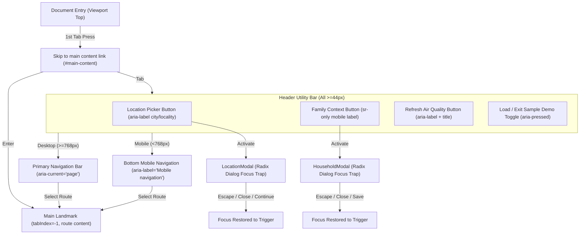
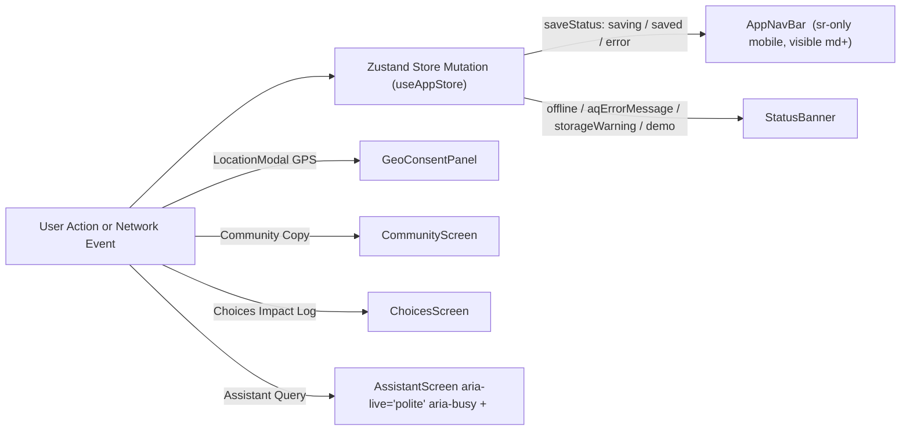
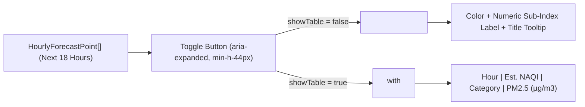

# Accessibility Compliance & Inclusive Design Architecture (WCAG 2.1 AA)

Saansathi treats accessibility, cognitive clarity, and assistive-technology interoperability as foundational engineering invariants rather than post-hoc visual polish. Because urban air-quality decisions often take place under time pressure—before a 6:30 AM school commute, while commuting on a mobile device, or when caring for older adults and children sensitive to winter smog—every interactive control, forecast visualization, alert banner, and modal dialog must remain perceivable, operable, understandable, and robust across desktop keyboards, mobile touchscreens, and screen readers.

Rather than relying on isolated unit assertions or partial landmark checks, Saansathi enforces **WCAG 2.1 Level AA compliance** across four coordinated layers: **(1) semantic HTML5 structure & focus geometry**, **(2) Tailwind v4 `@theme` high-contrast palette tokens**, **(3) cross-viewport live announcements & table parity**, and **(4) dual `axe-core` static + live headless Chromium verification**.

---

## 1. Accessibility Architecture & Focus-Flow Diagrams

### A. Keyboard Navigation, Skip-Link & Modal Focus-Trap Flow

Every route and dialog supports sequential keyboard navigation (`Tab` / `Shift+Tab`), predictable focus restoration, and zero keyboard traps.



### B. Screen-Reader Live-Region & Notification Pipeline

Dynamic application changes—local IndexedDB saves, browser geolocation prompts, clipboard exports, impact logs, offline transitions, and Groq AI completions—are routed through semantic `<output aria-live="polite">` elements that remain mounted in the accessible DOM across both mobile and desktop viewports.



### C. Dual-Mode Data Visualization Parity

Visual air-quality charts never strand non-visual users. `HourlyForecastChart.tsx` pairs a responsive bar figure with a one-click accessible HTML `<table>` toggle exposing explicit `<caption>` and `<th scope="col">` semantics.



---

## 2. WCAG 2.1 Level AA Compliance Matrix

| Criterion                      | Standard Requirement                                        | Saansathi Implementation                                                                                                                                            | Source Modules                                                                              | Verification                              |
| :----------------------------- | :---------------------------------------------------------- | :------------------------------------------------------------------------------------------------------------------------------------------------------------------ | :------------------------------------------------------------------------------------------ | :---------------------------------------- |
| **1.1.1 Non-text Content**     | Decorative icons hidden; meaningful figures/buttons labeled | All `lucide-react` icons set `aria-hidden="true"`; chart `<figure>` has descriptive `aria-label`                                                                    | `src/components/**`                                                                         | `oxlint` `jsx-a11y` + `axe-core`          |
| **1.3.1 Info & Relationships** | Landmarks, headings, lists, and tables encoded semantically | `<header>`, dual `<nav>`, `<main>`, `<footer>`, `<caption>`, `<th scope="col">`, `<fieldset>`/`<legend>`                                                            | `AppShell.tsx`, `HourlyForecastChart.tsx`, `EmissionFactorsTable.tsx`                       | `accessibility.test.tsx`                  |
| **1.4.1 Use of Color**         | Status never conveyed by color alone                        | India NAQI cards pair category color bands with explicit category labels (`Good`–`Severe`), numeric scores, and lead pollutant codes                                | `src/data/aqi-standards.ts`, `AqiHeroCard.tsx`                                              | Visual + `axe-core`                       |
| **1.4.3 Contrast (Minimum)**   | Normal text `>= 4.5:1`, large text `>= 3:1`                 | Warm high-contrast `@theme` palette (`#1C1917` on `#FAF7F2`/`#FFFFFF`, `#0F6E56` white-on-teal, `#1C1917` over amber Ask Saansathi highlight)                       | `src/index.css`, `AppNavBar.tsx`, `aqi-standards.ts`                                        | Playwright Chromium `axe-core`            |
| **2.1.1 Keyboard**             | All functionality operable via keyboard without traps       | Native `<button>`, `<select>`, `<input>`, `<details>`, Radix Dialog focus lock, responsive bar chart with zero non-focusable overflow                               | `Primitives.tsx`, `HourlyForecastChart.tsx`                                                 | Playwright `Tab` + `axe-core`             |
| **2.3.3 / 2.2.2 Motion**       | Respect user reduced-motion preferences                     | Global `@media (prefers-reduced-motion: reduce)` rule disables transitions, animations, and smooth scrolling                                                        | `src/index.css`                                                                             | Stylesheet audit                          |
| **2.4.1 Bypass Blocks**        | Mechanism to bypass repeated navigation blocks              | First-focus `Skip to main content` link targeting `#main-content` (`tabIndex={-1}`)                                                                                 | `src/components/layout/AppShell.tsx`                                                        | Playwright `saansathi.spec.ts`            |
| **2.4.4 Link Purpose**         | Clear link text and external window disclosure              | External citation links include descriptive institution text plus `<span className="sr-only"> (opens in new tab)</span>`                                            | `EmissionFactorsTable.tsx`, `AssistantMessageBubble.tsx`                                    | `screens.test.tsx`                        |
| **2.5.3 Label in Name**        | Accessible name begins with or contains visible label       | Paired `<label htmlFor="alert-threshold-select">` with `Alert threshold:`; repeated buttons prefix `Mark Done:`, `Accept:`, `Complete:`, `Check off:`               | `AlertsCard.tsx`, `HomeRoutinePreviewCard.tsx`, `RoutineScreen.tsx`, `IndoorActionCard.tsx` | `screens.test.tsx`                        |
| **2.5.5 Target Size**          | Generous pointer target sizing (`>= 44×44 px`)              | Header buttons, nav tabs, modal close (`h-11 w-11`), card toggles, alerts toggle, chart toggle, and quick prompts all enforce `min-h-[44px]`                        | `Primitives.tsx`, `AppShell.tsx`, `AppNavBar.tsx`, screens & modals                         | Stylesheet & component audit              |
| **4.1.2 Name, Role, Value**    | Every interactive control exposes accessible name & state   | Mobile `"Family Context"` exposes `sr-only sm:not-sr-only`; toggles expose `aria-pressed`; nav tabs expose `aria-current="page"`; chart toggle sets `aria-expanded` | `AppShell.tsx`, `RoutineScreen.tsx`, `IndoorActionCard.tsx`, `AlertsCard.tsx`               | `accessibility.test.tsx`                  |
| **4.1.3 Status Messages**      | Dynamic messages announced without stealing focus           | Semantic `<output aria-live="polite">` mounted for save status, `StatusBanner`, geolocation errors, clipboard copy, impact log, and AI progress                     | `AppNavBar.tsx`, `StatusBanner.tsx`, `GeoConsentPanel.tsx`, `AssistantScreen.tsx`           | `primitives.test.tsx`, `screens.test.tsx` |

---

## 3. Touch-Target, Focus & Color-Contrast Inventory

Every interactive control across desktop (`1280×800`) and mobile (`390×844`) viewports uses semantic Tailwind `@theme` design tokens (`src/index.css`) and meets a `>= 44 px` touch target footprint:

| Control Surface                                       | Accessible Name Pattern                                                                                 | State / Live Attribute            | Minimum Hit Area            | Color Pairing (`src/index.css`)                          |
| :---------------------------------------------------- | :------------------------------------------------------------------------------------------------------ | :-------------------------------- | :-------------------------- | :------------------------------------------------------- |
| **Location Picker** (`AppShell.tsx`)                  | `Change selected location, currently ...`                                                               | Modal trigger                     | `min-h-[44px]`              | `--color-ink` on `--color-surface`                       |
| **Family Context** (`AppShell.tsx`)                   | `Family Context` (`sr-only sm:not-sr-only`)                                                             | Modal trigger                     | `min-h-[44px]`              | `--color-ink` on `--color-surface`                       |
| **Refresh AQ** (`AppShell.tsx`)                       | `Refresh air quality data`                                                                              | `disabled` during load/demo       | `min-h-[44px]`              | `--color-ink` on `--color-surface`                       |
| **Sample Demo Toggle** (`AppShell.tsx`)               | `Load Sample Demo` / `Exit Sample Demo`                                                                 | `aria-pressed={isDemoMode}`       | `min-h-[44px]`              | `--color-ink-body` / `amber-950`                         |
| **Nav Tabs (`Home`..`Community`)** (`AppNavBar.tsx`)  | Visible label (`shortLabel` mobile)                                                                     | `aria-current="page"` when active | `min-h-[44px] min-w-[44px]` | White on `--color-brand` (`#0F6E56`)                     |
| **Ask Saansathi Highlight Tab** (`AppNavBar.tsx`)     | `Ask Saansathi` / `Assistant`                                                                           | `aria-current="page"` when active | `min-h-[44px] min-w-[44px]` | `#1C1917` over `amber-300/20`–`/45` + `amber-600` border |
| **Modal Close Button** (`Primitives.tsx`)             | `Close dialog`                                                                                          | Radix `Dialog.Close`              | `h-11 w-11` (`44×44 px`)    | `--color-ink` on `--color-surface`                       |
| **Location Delete Button** (`SavedLocationsList.tsx`) | `Remove saved location <City>`                                                                          | Conditional when `presets > 1`    | `h-11 w-11` (`44×44 px`)    | `--color-ink-muted` / `red-700` hover                    |
| **Chart Table Toggle** (`HourlyForecastChart.tsx`)    | `View accessible data table` / `Show visual chart`                                                      | `aria-expanded={showTable}`       | `min-h-[44px]`              | `--color-ink` on `--color-canvas`                        |
| **Alert Pause / Threshold** (`AlertsCard.tsx`)        | `Pause alerts` / `Alert threshold:`                                                                     | `aria-pressed={!enabled}`         | `min-h-[44px]`              | `--color-ink` on `--color-surface`                       |
| **Home & Routine Card Toggles**                       | `Mark Done: <Title>`, `Accept: <Title>`, `Complete: <Title>`, `Alternative: <Title>`, `Dismiss <Title>` | `aria-pressed`                    | `min-h-[44px]`              | `--color-brand` / `--color-surface`                      |
| **Indoor Action Toggle** (`IndoorActionCard.tsx`)     | `Check off: <Title>` / `Checked: <Title>`                                                               | `aria-pressed={isDone}`           | `min-h-[44px]`              | `--color-brand` / `--color-surface`                      |
| **Assistant Quick Prompts** (`AssistantScreen.tsx`)   | Prompt question text                                                                                    | `disabled={loading}`              | `min-h-[44px]`              | `--color-ink` on `--color-canvas`                        |

---

## 4. Route-by-Route Assistive Technology & Landmark Map

| Route / Dialog                              | Primary `<h1>` / Title                      | Landmarks & Tables                                                                               | Live Regions & Dynamic Feedback                                                     |
| :------------------------------------------ | :------------------------------------------ | :----------------------------------------------------------------------------------------------- | :---------------------------------------------------------------------------------- |
| **`Home` (`HomeScreen.tsx`)**               | Active city/locality (`<h1>`)               | `banner`, `nav`, `main`, `contentinfo`; optional forecast `<table>` (`<caption>`, `scope="col"`) | `StatusBanner` (`<output>`), `AppNavBar` save status (`<output>`)                   |
| **`My Routine` (`RoutineScreen.tsx`)**      | `My Household Daily Routine`                | Expandable `<details>` reasoning/caveat panels per recommendation                                | Unique `Accept:` / `Complete:` / `Alternative:` / `Dismiss` `aria-pressed` states   |
| **`Indoor Air` (`IndoorScreen.tsx`)**       | `Indoor Air-Quality Toolkit`                | `<fieldset>` + `<legend>` for indoor smoke source checkboxes                                     | Combustion safety interlock alert block + `Check off:` `aria-pressed`               |
| **`Better Choices` (`ChoicesScreen.tsx`)**  | `Better Choices & Trade-Off Explorer`       | Explicit Baseline vs. Exposure vs. Emissions comparison cards                                    | `role="alert"` on cycling/walking smog conflict + `<output>` log confirmation       |
| **`Impact` (`ImpactScreen.tsx`)**           | `Transparent Choice Impact Engine`          | `EmissionFactorsTable` `<caption>`, 5 `scope="col"` headers, `<details>` assumptions             | New-tab `(opens in new tab)` sr-only hint on WRI India source URLs                  |
| **`Community` (`CommunityScreen.tsx`)**     | `Community Organizer Workspace`             | Form controls with explicit `<label>` wrapping + per-action status `<select>`                    | `<output aria-live="polite">` clipboard summary confirmation                        |
| **`Ask Saansathi` (`AssistantScreen.tsx`)** | `Ask Saansathi (Contextual Assistant)`      | `<form>` with `<label htmlFor="saansathi-question">` + quick prompt grid                         | `aria-live="polite"` `aria-relevant="additions"` `aria-busy={loading}` + `<output>` |
| **`LocationModal` & `HouseholdModal`**      | Radix `Dialog.Title` & `Dialog.Description` | Focus-trapped dialogs, `<fieldset>`/`<legend>` for priority protection flags                     | `GeoConsentPanel` `<output aria-live="polite">` GPS permission & error status       |
| **`ErrorBoundary` (`ErrorBoundary.tsx`)**   | `This view could not be loaded`             | `role="alert"` recovery panel                                                                    | One-click `Return to Home Dashboard` recovery button (`min-h-[44px]`)               |

---

## 5. Multi-Layer Accessibility Testing & Verification Strategy

Saansathi verifies accessibility at three distinct stages—static lint rules, unit/component DOM audits, and real-browser rendered contrast execution—so regressions fail CI immediately rather than slipping through manual review.

### Layer 1: Static JSX Accessibility Linting (`oxlint` + `jsx-a11y`)

- Configured in `.oxlintrc.json` with `"plugins": ["react", "typescript", "oxc", "jsx-a11y"]` scanning **all 105 files** across `src/`, `api/`, and `tests/`.
- Enforces semantic HTML tags (`prefer-tag-over-role`, e.g., `<output>` instead of `<span role="status">` and `<section>` instead of `<div role="region">`), prohibits `tabIndex` on non-interactive elements (`no-noninteractive-tabindex`), and validates ARIA attributes (`0` warnings, `0` errors).

### Layer 2: Comprehensive `axe-core` Unit Suite (`tests/unit/ui/accessibility.test.tsx`)

- Renders the full `App` shell (`HomeScreen` + navigation + footer) plus every individual route (`RoutineScreen`, `IndoorScreen`, `ChoicesScreen`, `ImpactScreen`, `CommunityScreen`, `AssistantScreen`) and open dialogs (`LocationModal` with `GeoConsentPanel` expanded, and `HouseholdModal`).
- Runs `axe.run()` across **all violation severities** (`critical`, `serious`, `moderate`, and `minor`—zero filtered warnings; `expect(results.violations).toEqual([])`).
- Programmatically verifies `banner`, `main`, `contentinfo` landmarks, `#main-content` skip link presence, `"Family Context"` accessible name, and `scope="col"` attributes on `ImpactScreen` table headers.

### Layer 3: Real-Browser Chromium `axe-core` & Keyboard E2E (`tests/e2e/saansathi.spec.ts`)

Because `jsdom` does not compute CSS layout or canvas pixel contrast, `tests/e2e/saansathi.spec.ts` runs real **Playwright Chromium** accessibility tests against the built production preview (`npm run build && npm run preview`):

- **Keyboard Skip-Link Focus Test:** Presses `Tab` from top of page and asserts `Skip to main content` receives keyboard focus.
- **Rendered CSS `color-contrast` + Scrollable Region Audit:** Injects `node_modules/axe-core/axe.min.js` directly into Chromium via `page.addScriptTag` and runs full `axe.run()` (including `color-contrast` and `scrollable-region-focusable`) on both the **Home** dashboard and the **amber-highlighted Ask Saansathi** assistant view—passing with **zero violations (`[]`)**.
- **Interactive Assistive Semantics in E2E:** Verifies mobile bottom navigation (`390×844`), chart-to-table switching (`table` + `columnheader` `Est. NAQI`), and `role="alert"` announcement when evaluating cycling under elevated NAQI.

### Reproducible Accessibility Verification Commands

```bash
npm run lint           # Runs oxlint jsx-a11y static rules across all 105 files (0 warnings)
npx vitest run tests/unit/ui/accessibility.test.tsx   # All 7 routes + both modals axe-core audit
npm run e2e            # Real Chromium Playwright E2E + live CSS color-contrast & skip-link tests
```

> **Transparency Note:** Automated static linting, unit `axe-core`, and Chromium `axe-core` contrast verification eliminate structural, ARIA, contrast, and keyboard-focus regressions cleanly. Periodic manual testing with NVDA, VoiceOver, and TalkBack remains good practice whenever adding future voice or charting features.
