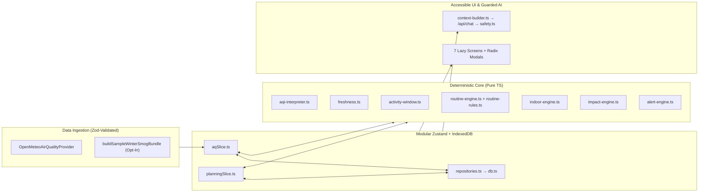

# Architecture — Saansathi

## Core / Shell Separation

Saansathi uses a strict **Deterministic Core + AI Shell** architecture built on **Vite + React 19 + TypeScript + Tailwind CSS v4 + Zustand + IndexedDB**. Client-first SPAs with IndexedDB persistence benefit directly from Vite SPA architecture without server-component boundary dissonance.

## Module Responsibilities

- **Domain Models (`src/domain/`):** Strictly typed TypeScript interfaces inferred from Zod schemas (`air-quality`, `household`, `routine`, `indoor`, `impact`, `alerts`, `community`).
- **Static Data Registries (`src/data/`):** Official CPCB NAQI breakpoints, 6 pollutant profiles, 15 Indian city presets, 7 indoor templates, WRI India emission factors, community starter actions, and 7 authoritative source URLs.
- **Deterministic Core (`src/engines/`):** Pure functions with zero browser or LLM dependencies:
  - `aqi-interpreter.ts`: CPCB India NAQI linear interpolation, 3-pollutant coverage check, CO unit normalization, explicit non-substitution of foreign scales.
  - `freshness.ts`: Timestamp age classification (`recent`, `delayed`, `last_known`, `stale`, `forecast`, `unavailable`).
  - `activity-window.ts`: Linear scan of upcoming daytime (06:00–21:00) 2-hour windows sorted by lowest model-estimated NAQI.
  - `routine-engine.ts` + `routine-rules.ts`: Schedule-aware daily adjustments factoring vulnerability protection flags, outdoor work, and Severe-AQI cycling safety.
  - `indoor-engine.ts`: Source control, CADR sizing guidance, ozone prohibition, and gas/biomass combustion ventilation warnings.
  - `impact-engine.ts`: Passenger-km emission math strictly decoupled from qualitative personal exposure considerations.
  - `alert-engine.ts`: Threshold, forecast spike, and 14-day purifier maintenance reminders deduplicated by `dedupKey`.
- **Modular Store (`src/store/`):** Zustand store composed cleanly from `aqSlice.ts` and `planningSlice.ts`, keeping every module under 180 lines.
- **AI Shell (`api/chat.ts`, `api/_guardrails.ts`, `src/ai/`):** Server-side Gemini 3.1 Flash Lite (`gemini-3.1-flash-lite`) integration strictly for natural-language synthesis, bounded by minimal city-only context (`src/ai/context-builder.ts`), Zod schemas, urgent symptom redirect, and `sanitizeAiResponse` (`src/ai/safety.ts`), with seamless deterministic offline fallback (`src/ai/client.ts`).
