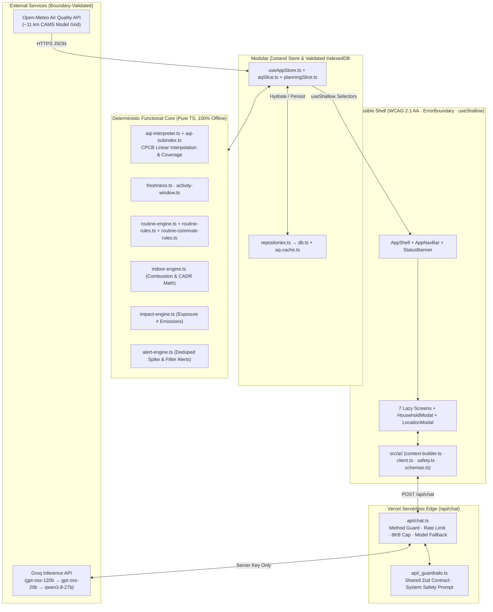

# Architecture — Saansathi

## 1. Architectural Philosophy: Functional Core / Imperative Shell

Saansathi is engineered as a **Vite + React 19 + TypeScript** local-first Single Page Application (SPA) backed by a lightweight Vercel serverless AI edge endpoint (`/api/chat`). Selecting Vite SPA over SSR/App-Router frameworks eliminates unnecessary client/server boundary overhead for a 100% browser-persisted IndexedDB planning engine while preserving instantaneous route-level code splitting via `React.lazy` and `ErrorBoundary` fault containment.

---

## 2. Design Patterns & Structural Invariants

| Pattern / Practice                        | Implementing Modules                                                           | Engineering Benefit                                                                                   |
| :---------------------------------------- | :----------------------------------------------------------------------------- | :---------------------------------------------------------------------------------------------------- |
| **Functional Core / Imperative Shell**    | `src/engines/*`, `src/storage/*`, `src/components/*`                           | Zero UI or storage coupling inside calculations; 100% deterministic unit testability                  |
| **Modular Zustand Slices + `useShallow`** | `src/store/useAppStore.ts`, `aqSlice.ts`, `planningSlice.ts`                   | Eliminates monolithic mega-hooks and prevents full-tree re-renders on unrelated slice mutations       |
| **Single-Source Zod Contracts**           | `src/ai/schemas.ts`, `src/data/evidence-ids.ts`, `api/_guardrails.ts`          | Shared runtime schemas validate both browser AI clients and serverless handlers with zero duplication |
| **Single-Flight Request Guard**           | `activeAqRequestId` in `src/store/aqSlice.ts`                                  | Prevents stale out-of-order network responses from overwriting rapid location switches                |
| **Fault-Contained Lazy Routes**           | `src/App.tsx`, `src/components/ui/ErrorBoundary.tsx`                           | Recovers gracefully from offline chunk-load errors or unexpected component exceptions                 |
| **Safe `<select>` Enum Parsing**          | `src/domain/select-guards.ts` (`parseEnumValue`)                               | Eliminates unvalidated `as` type casts across every interactive dropdown                              |
| **Strict `<= 200`-Line Modularity**       | Enforced across every `src/` and `api/` file (`tests/quality/hygiene.test.ts`) | Keeps UI cards, modals, stores, and engines crisp, cohesive, and single-responsibility                |
| **Tailwind v4 `@theme` Design Tokens**    | `src/index.css`                                                                | Centralizes high-contrast warm palette tokens (`bg-canvas`, `text-ink`, `bg-brand`, `text-amber-ink`) |

---

## 3. Module Breakdown

- **Domain Models (`src/domain/`):** Strict Zod schemas and inferred TypeScript types across 7 bounded domains (`air-quality`, `alerts`, `community`, `household`, `impact`, `indoor`, `routine`) plus `select-guards.ts`.
- **Authoritative Static Registries (`src/data/`):** CPCB NAQI breakpoints (`aqi-standards.ts`), pollutant education catalog (`pollutants.ts`), 15 Indian city presets (`cities.ts`) + demo defaults (`demo-defaults.ts`), evidence-based indoor actions (`indoor-actions.ts`), WRI India / CEA transport factors (`emission-factors.ts` + `motorized-emission-factors.ts`), community starter templates (`community-templates.ts`), and canonical `SOURCE_REGISTRY` (`sources.ts` + `evidence-ids.ts`).
- **Deterministic Decision Engines (`src/engines/` — all `< 180` lines):**
  - `aqi-interpreter.ts` + `aqi-subindex.ts`: CPCB NAQI sub-index calculation, CO normalization (`µg/m³ -> mg/m³`), 3-pollutant coverage check, and non-substitution of foreign indices.
  - `freshness.ts`: Observation timestamp age classification (`recent`, `delayed`, `last_known`, `stale`, `forecast`, `unavailable`).
  - `activity-window.ts`: Linear scan of upcoming daytime (06:00–21:00) 2-hour pairs ranked by lowest model-estimated NAQI.
  - `routine-engine.ts` + `routine-rules.ts` + `routine-commute-rules.ts`: Schedule-aware daily recommendations factoring protection flags, outdoor-worker pacing, and Severe-AQI cycling blocks.
  - `indoor-engine.ts`: Source-control prioritization, CADR bedroom coverage (`CADR / 12`), ozone prohibition, and gas/biomass ventilation safety warnings.
  - `impact-engine.ts`: Passenger-km emission math using $O(1)$ `EMISSION_FACTOR_BY_MODE` lookups strictly separated from qualitative personal exposure considerations.
  - `alert-engine.ts`: Threshold, 12-hour forecast spike, and 14-day HEPA filter reminders deduplicated via `dedupKey`.
- **Validated Local Storage (`src/storage/`):** `db.ts` (KV envelopes & schema registry), `aq-cache.ts` (air-quality reading/forecast cache), and `repositories.ts` (typed facade) with error propagation into `StatusBanner.tsx`.
- **Guarded GenAI Shell (`api/`, `src/ai/`):** Server-side Groq integration (`openai/gpt-oss-120b` with fallback to `openai/gpt-oss-20b` and `qwen/qwen3.8-27b`), city-only privacy minimization (`context-builder.ts`), shape normalization (`normalizeLlmJson`), urgent medical symptom redirects (`112 / 108`), and safety sanitization (`safety.ts`) with deterministic offline fallback (`client.ts`).
