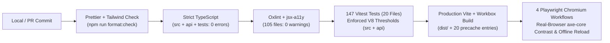

# Testing Strategy, Coverage Report & Quality Gate Verification

Saansathi treats automated verification as a first-class architectural pillar. Every calculation engine, schema boundary, IndexedDB adapter, Zustand concurrency rule, serverless Groq endpoint, accessibility invariant, and real-browser workflow is verified across **four deterministic test layers** backed by strict compiler checks, zero-warning linting, and enforced V8 coverage thresholds across both `src/` and `api/`.

---

## 1. Continuous Integration Pipeline & Quality Gate Architecture



---

## 2. Verification Summary & Enforced Gate Metrics

| Verification Layer              | Tooling & Configuration                                                             | Scope & Enforced Thresholds                                                                                                                                               | Observed Result                                                  |
| :------------------------------ | :---------------------------------------------------------------------------------- | :------------------------------------------------------------------------------------------------------------------------------------------------------------------------ | :--------------------------------------------------------------- |
| **Strict Type Checking**        | `tsc -b --noEmit` (`tsconfig.app.json`, `tsconfig.node.json`, `tsconfig.test.json`) | `strict`, `noImplicitAny`, `strictNullChecks`, `noUncheckedIndexedAccess`, `noUnusedLocals/Parameters` across `src/`, `api/`, and `tests/`                                | **0 errors**                                                     |
| **Static & A11y Linting**       | `oxlint` (`.oxlintrc.json`)                                                         | `react`, `typescript`, `oxc`, and `jsx-a11y` rules across **105 files** (zero test exclusions)                                                                            | **0 warnings, 0 errors**                                         |
| **Formatting Consistency**      | `prettier --check .` + `prettier-plugin-tailwindcss`                                | All TypeScript, TSX, JSON, CSS, and Markdown files                                                                                                                        | **100% compliant**                                               |
| **Unit, Integration & Hygiene** | `vitest run --coverage` (`vitest.config.ts`)                                        | **20 test files** covering engines, Zod boundaries, registries, providers, IndexedDB, store slices, `/api/chat`, UI screens, modals, `ErrorBoundary`, `axe-core`, hygiene | **147 / 147 passing**                                            |
| **V8 Coverage Gate**            | `@vitest/coverage-v8` (`src/**/*.ts(x)` + `api/**/*.ts`)                            | Enforced minimums: `90%` stmts · `82%` branches · `88%` funcs · `90%` lines                                                                                               | **93.38% stmts · 82.96% branches · 93.47% funcs · 95.46% lines** |
| **Production PWA Bundle**       | `tsc -b && vite build` (`vite-plugin-pwa`)                                          | Route-level lazy chunking + Workbox manifest generation                                                                                                                   | **416 ms build · 20 entries (568.24 KiB)**                       |
| **Real-Browser E2E & A11y**     | `@playwright/test` (`tests/e2e/saansathi.spec.ts`)                                  | 4 Chromium workflows + injected `axe-core` CSS `color-contrast` & keyboard focus tests                                                                                    | **4 / 4 passing (0 axe violations)**                             |

---

## 3. Detailed Module Coverage Breakdown (`npm run coverage`)

| Module Group                                   | Representative Files Verified                                                                                                                                   |  Statements   |   Branches    |   Functions   |     Lines     |
| :--------------------------------------------- | :-------------------------------------------------------------------------------------------------------------------------------------------------------------- | :-----------: | :-----------: | :-----------: | :-----------: |
| **All Measured (`src/` + `api/`)**             | Full client core, UI shell, and serverless edge handler                                                                                                         | **`93.38%`**  | **`82.96%`**  | **`93.47%`**  | **`95.46%`**  |
| **Serverless API (`api/`)**                    | `api/chat.ts`, `api/_guardrails.ts`                                                                                                                             |   `93.40%`    |   `89.83%`    | **`100.00%`** |   `93.97%`    |
| **Decision Engines (`src/engines/`)**          | All 10 pure NAQI, routine, indoor, impact, window, freshness & alert modules                                                                                    |   `93.92%`    |   `89.13%`    | **`100.00%`** |   `96.88%`    |
| **GenAI Safety & Client (`src/ai/`)**          | `context-builder.ts`, `safety.ts`, `schemas.ts`, `client.ts`                                                                                                    |   `95.23%`    |   `89.13%`    |   `81.25%`    | **`100.00%`** |
| **Data & Domain (`src/data/`, `src/domain/`)** | CPCB breakpoints, 15 cities, emission factors, 7 Zod domain schemas                                                                                             | **`100.00%`** | **`100.00%`** | **`100.00%`** | **`100.00%`** |
| **Providers (`src/providers/`)**               | `open-meteo.ts`, `open-meteo-schema.ts`, `sample-data.ts`, `types.ts`                                                                                           |   `94.94%`    |   `88.88%`    |   `81.81%`    |   `97.87%`    |
| **UI Primitives & Core Screens**               | `Primitives.tsx`, `ErrorBoundary.tsx`, `StatusBanner.tsx`, `AlertsCard.tsx`, `ImpactScreen.tsx`, `ChoicesScreen.tsx`, `RoutineScreen.tsx`, `HouseholdModal.tsx` | **`100.00%`** |  `75%–100%`   | **`100.00%`** | **`100.00%`** |
| **Zustand Store (`src/store/`)**               | `aqSlice.ts`, `planningSlice.ts`, `useAppStore.ts`, `defaults.ts`                                                                                               |   `90.35%`    |   `68.18%`    |   `90.62%`    |   `93.06%`    |

---

## 4. Automated Test Suite Inventory (`147` Vitest Tests Across `20` Files)

| Suite Category                  | File(s)                                                                                             | Count | Key Edge Cases & Negative Boundaries Verified                                                                                                                                                                                                                                       |
| :------------------------------ | :-------------------------------------------------------------------------------------------------- | :---: | :---------------------------------------------------------------------------------------------------------------------------------------------------------------------------------------------------------------------------------------------------------------------------------- |
| **India NAQI Engine**           | `tests/unit/engines/aqi-interpreter.test.ts`                                                        |  13   | All 6 pollutants (`PM2.5`, `PM10`, `NO2`, `SO2`, `CO`, `O3`), `CO` `µg/m3 -> mg/m3` conversion, `< 3` pollutant rule, `1h vs 24h/8h` disclosure, `> 500` extrapolation, negative/NaN rejection, zero US EPA/EAQI substitution                                                       |
| **Activity Windows**            | `tests/unit/engines/activity-window.test.ts`                                                        |   8   | Daytime `06:00–21:00` pair scoring, ascending NAQI sort, `> 200` elevated caveat, `null` interpolation gaps, 12h formatting                                                                                                                                                         |
| **Routine Planner**             | `tests/unit/engines/routine-engine.test.ts`                                                         |   9   | Morning indoor swap, protection-flag sensitivity at `Moderate`, `outdoor_work` PPE caveats, hybrid/remote vs. metro vs. carpool, Severe cycling exclusion, `null` reading safety                                                                                                    |
| **Indoor Air Toolkit**          | `tests/unit/engines/indoor-engine.test.ts`                                                          |  10   | LPG/PNG/biomass exhaust requirement vs. induction kitchens, ozone generator ban, CADR `m3/h -> m2` bedroom sizing, budget filtering, door-sealing thresholds                                                                                                                        |
| **Impact & Emissions**          | `tests/unit/engines/impact-engine.test.ts`                                                          |   9   | WRI India / CEA passenger-km arithmetic, preserved `null` tailpipe PM2.5/NOx on EV/Metro/Bus, zero/invalid trip fallback, Severe cycling warning                                                                                                                                    |
| **Alerts & Freshness**          | `tests/unit/engines/alert-and-freshness.test.ts`                                                    |  11   | All freshness states (`recent`, `delayed`, `last_known`, `stale`, `forecast`, `unavailable`), threshold transitions, 12h forecast spikes, 14-day HEPA filter check, `dedupKey` uniqueness                                                                                           |
| **Domain & Registry Contracts** | `schemas.test.ts` (9), `registries.test.ts` (5)                                                     |  14   | Boundary validation across 7 Zod domain schemas + AI schemas; monotonic CPCB tables, India lat/lon bounds for 15 cities, HTTPS citation URLs                                                                                                                                        |
| **Open-Meteo Adapter**          | `tests/unit/providers/open-meteo.test.ts`                                                           |   4   | Valid mapping, `null` omission, invalid lat/lon rejection (`-90..90`, `-180..180`), HTTP `429`/5xx, malformed JSON, schema failure, `AbortError` timeout, pre-aborted caller `AbortSignal`                                                                                          |
| **IndexedDB & Store Slices**    | `indexeddb.test.ts` (6), `app-store.test.ts` (7)                                                    |  13   | IndexedDB round-trips, corrupted record quarantine, invalid payload rejection, storage failure propagation (`storageWarning`), `saansathi_location_prompted` reset cleanup, single-flight `activeAqRequestId` race guard, offline AQ cache fallback                                 |
| **AI Privacy & Safety Rails**   | `tests/unit/ai/ai-safety-and-context.test.ts`                                                       |   7   | Coordinates/locality/household name stripping, urgent symptom redirect (`112/108`) with zero `fetch`, ozone/medication/gas-sealing/Severe-cycling filtering, invalid URL fallback, caller `AbortSignal`, deterministic offline fallback                                             |
| **Serverless `/api/chat`**      | `tests/unit/ai/server-endpoint.test.ts`                                                             |  10   | `stripJsonFences`, `normalizeLlmJson` coercion, `405` non-POST, `413` `> 8 KB`, `400` malformed JSON/Zod, `503` missing key, mocked Groq `200 OK`, `503 -> 200` model cascade, `502` malformed LLM output, upstream `429 AI_RATE_LIMIT`, 20-req/min IP `429 RATE_LIMITED`           |
| **UI Screens & Onboarding**     | `screens.test.tsx` (19), `modals.test.tsx` (5), `primitives.test.tsx` (4), `app-shell.test.tsx` (2) |  30   | All 7 lazy routes, `groq_ai` completion + `safetyWarnings` banner, debounced community writes + clipboard export, geolocation grant/deny/error/unavailable, `HouseholdModal` fresh prop sync, `StatusBanner` warnings, `ErrorBoundary` crash recovery, `online`/`offline` listeners |
| **Accessibility Audits**        | `tests/unit/ui/accessibility.test.tsx`                                                              |   3   | Full `axe-core` audit (all violation severities) across `AppShell` + all 7 routes + `LocationModal` + `HouseholdModal`, landmarks, skip link, `scope="col"`, unique button names                                                                                                    |
| **Pipeline & Code Hygiene**     | `end-to-end-pipeline.test.ts` (1), `hygiene.test.ts` (5)                                            |   6   | Full Open-Meteo -> NAQI -> Engines -> AI Context -> IndexedDB pipeline; required manifests, `.gitignore` `.env.example`, `node >= 20`, zero `any`/`@ts-ignore`/client `console.*`/Gemini leftovers/keys, **strict `<= 200`-line limit** across `src/` & `api/`                      |

---

## 5. Playwright Chromium E2E Workflows (`tests/e2e/saansathi.spec.ts` — 4 Workflows)

1. **Onboarding, Demo Mode & Offline Reload Persistence:** Verifies automatic first-launch `LocationModal`, Sample Demo banner toggle, custom locality addition, Household profile persistence, offline network reload, and live reconnection refresh.
2. **Core Household & Community Planning Flows:** Exercises chart-to-accessible-table switching, Routine completion, Indoor source-control checklist, Severe-smog cycling conflict alert, Choices -> Impact math logging, and Community organizer checklist updates.
3. **Mobile Navigation, Live Mocked Groq AI, Medical Redirect & Offline Fallback:** Runs at `390×844` mobile viewport, validates mocked `/api/chat` `200 OK` structured citations, verifies local urgent medical redirect (`112 / 108`), and confirms automatic deterministic offline fallback when unrouted offline.
4. **Real-Browser Chromium `axe-core` WCAG 2.1 AA Contrast & Skip-Link Audit:** Verifies keyboard `Tab` focus on `Skip to main content`, injects `axe-core` into rendered Chromium pages, and confirms **zero violations** (including CSS `color-contrast` and `scrollable-region-focusable`) on Home and the amber-highlighted Ask Saansathi route.

---

## 6. Verification Commands

```bash
npm run typecheck      # Strict tsc -b --noEmit across src/, api/, and tests/
npm run lint           # Oxlint across 105 files (0 warnings, 0 errors)
npm run format:check   # Prettier + Tailwind CSS formatting check
npm run test           # 147 Vitest unit, integration, accessibility & hygiene tests
npm run coverage       # V8 coverage + threshold enforcement across src/ + api/
npm run build          # Production tsc -b + Vite + Workbox PWA bundle
npm run e2e            # Build preview & execute all 4 Playwright Chromium E2E workflows
npm run check          # Combined CI verification gate
```
